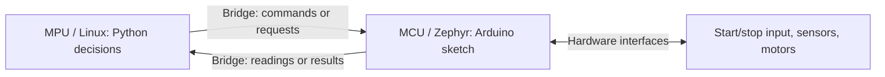

# Robocar pre-work and references

[Robocar guide](README.md) · [Arduino references](#arduino-references)

Allow about **30 minutes**, plus download time. This estimate includes the MPU/MCU introduction, computer preparation, and a starter walkthrough. No board is needed for the reading and code walkthrough.

By the end, you should be able to explain what runs on each UNO Q processor, why that split helps your project, and what information crosses between them. Familiarity with variables, functions, loops, and conditionals is useful; you will develop the hardware-specific parts during the session.

## 1. Understand MPU and MCU roles — about 10 minutes

An **MPU (microprocessor unit)** is suited to general-purpose computing, typically using external RAM and storage to run an operating system and applications. An **MCU (microcontroller unit)** combines a processor, memory, and hardware peripherals on one chip for embedded control.

The UNO Q has both. Its Qualcomm Dragonwing **QRB2210 MPU runs Debian Linux**, while its **STM32U585 MCU runs Arduino sketches on Zephyr**, a real-time operating system. See Arduino's [UNO Q overview](https://docs.arduino.cc/hardware/uno-q/) and the architecture section of the [UNO Q user manual](https://docs.arduino.cc/tutorials/uno-q/user-manual/).

| Aspect | MPU: computing and application logic | MCU: hardware interaction and timing |
| --- | --- | --- |
| Strengths | More compute and memory for images, Python libraries, networking, files, and Linux applications | Direct hardware interfaces, timers, and predictable control with a smaller memory and power budget |
| Programming in this starter | Python in `python/` | Arduino C++ in `sketch/sketch.ino`, with `setup()` for initialization and `loop()` for repeated work |
| Tradeoffs | Linux schedules multiple tasks; a Python loop is not a guarantee of precise hardware timing | Less memory and compute; long or blocking sketch work can still delay input handling and timer checks |
| Robocar responsibility | Decode camera images, detect the ball, choose the next movement | Handle motor commands, sensors, the start/stop input, and timed motor stops |

**Real-time** means responding within a required time bound, not simply running calculations faster. The MCU is a good home for timing-sensitive work, but the sketch still has to be written to service it promptly. An MCU can run an OS, as this one does; the distinction is about resources and responsibilities, not just whether an OS is present.

## 2. Follow how they work together — about 5 minutes

Arduino App Lab manages the Python program and Arduino sketch as one app. Both programs run on the UNO Q; your connected computer provides the editor. **Bridge** connects the two programs using remote procedure calls (RPC): one side asks the other to run a named function and exchange values. Read the C++ and Python sections of the [Bridge API reference](https://docs.arduino.cc/software/app-lab/bridge/bridge-api).

In this starter, the sketch exposes named functions with `Bridge.provide_safe(...)`. Python calls them with `Bridge.call(...)`, which waits for a response. Method names, argument order, and return values must agree on both sides. They are separate programs exchanging messages, so calls take time and can fail.

Python requests a short movement and the MCU checks when to stop its motor output; the Python wrapper waits before the routine continues to the next observation. This uses Linux's software ecosystem alongside dedicated hardware control. Keep messages small and retain the starters' stop, timeout, and error handling.

## 3. Prepare your computer — about 5 minutes, plus download time

1. Install and open Arduino App Lab using its [setup guide](https://docs.arduino.cc/software/app-lab/setup/overview/). Read the [board connection guide](https://docs.arduino.cc/software/app-lab/configure/config/); complete board connection when you receive your kit.
2. Download this repository and locate your track's `app.yaml`, `python/`, and `sketch/`. The [Robocar guide](README.md) explains packaging and importing them together.
3. Bring a data-capable USB-C cable. The kits are preassembled; keep their prepared wiring and board software in place. If installation is blocked, record the error for setup help and continue the reading and code walkthrough.

**Check your understanding:** choose one task for the MPU and one for the MCU in your track. Explain why each belongs there, and name one command and one result that must cross Bridge. Then continue with the starter walkthrough below.

## 4. Walk through the starter — about 10 minutes

1. **Trace a movement request.** Open [`python/main.py`](python/main.py), find `robot.drive("forward", speed=100, ms=200)`, and follow `drive()` in [`python/robot_client.py`](python/robot_client.py) to `Bridge.call("drive", ...)`. In [`sketch/sketch.ino`](sketch/sketch.ino), find the matching `Bridge.provide_safe("drive", rpcDrive)` and `updateDriveTimer()`. Identify where the command originates and where the motor stop timer is checked.
2. **Separate perception from control.** Read the [camera flow](README.md#3-open-the-camera-stream). The ESP32-S3 is a separate camera controller: video reaches the UNO Q's MPU over Wi-Fi, while the camera's BOOT button reaches the UNO Q's MCU over I2C. Plan to put image decoding and ball detection in Python, and keep motor output and timed-stop handling in the sketch.
3. **Sketch one decision cycle.** On paper, write what should happen for a ball on the left, in the center, or missing. Use a short movement followed by a fresh observation; stop when the ball or video is unavailable. Read Arduino's [Blink Without Delay](https://docs.arduino.cc/built-in-examples/digital/BlinkWithoutDelay/) for the elapsed-time pattern used to keep a sketch responsive. This is a reading exercise; keep the supplied firmware on the robot.

**Ready for the session:** you can trace “camera → Python decision → Bridge command → MCU motor output,” explain why an MCU timer is preferable to relying only on a later Python stop command, and name the stale-video check Python still needs. The timer depends on the sketch continuing to run; it is not a physical power cutoff. When you receive the robot, use the [raised-wheel movement](README.md#2-run-the-starter) as your first hardware checkpoint.

## Arduino references

Use these as lookups during this track; you do not need to read every page end to end.

| Official documentation | What to focus on |
| --- | --- |
| [UNO Q user manual](https://docs.arduino.cc/tutorials/uno-q/user-manual/) | Board architecture, processor roles, connectors, and operating limits |
| [App Lab setup](https://docs.arduino.cc/software/app-lab/setup/overview/) and [board connection](https://docs.arduino.cc/software/app-lab/configure/config/) | Installing the development environment and connecting to the board |
| [Bridge API reference](https://docs.arduino.cc/software/app-lab/bridge/bridge-api) | How Python movement commands and sensor requests reach registered sketch functions |
| [Debian Linux basics for UNO Q](https://docs.arduino.cc/tutorials/uno-q/debian-guide/) | The Linux environment where camera networking, Python packages, and your detector run |
| [Blink Without Delay](https://docs.arduino.cc/built-in-examples/digital/BlinkWithoutDelay/) | Checking elapsed time without suspending the whole sketch with a long delay |
| [I2C protocol and the Wire library](https://docs.arduino.cc/learn/communication/wire/) | Addressed communication between the MCU and attached devices; use this kit's wiring and addresses from the [hardware reference](README.md#hardware-and-camera-reference) |

